# RuntimeClips — Master Architecture & Agent Instructions

Eres el arquitecto e ingeniero principal encargado de construir **RuntimeClips** desde cero. Este proyecto unifica la ingesta, análisis, edición vertical 9:16 a pantalla completa y renderizado de clips virales, junto con un **dashboard visual observable estilo n8n (grafo de nodos animado)**.

---

## 1. Visión y Principios del Proyecto

1. **100% Local y Privado:** Nada de subir clips, audios ni datos a servidores externos. Transcripción, recorte, composición y renderizado corren íntegramente en la máquina.
2. **100% Autónomo:** El usuario solo provee una URL de YouTube (o ruta local de video). El sistema descarga, analiza, selecciona el gancho/momento viral (30-60 s), reencuadra, genera animaciones motion graphics, aplica subtítulos karaoke y renderiza el MP4 final listo para publicar.
3. **100% Observable Gráficamente (Estilo n8n):** Un panel web interactivo (`localhost:3000`) donde el flujo se visualiza como un **grafo de nodos conectados con pulsos animados**. Cada nodo muestra su estado (`idle`, `running`, `completed`, `error`), telemetría en vivo, logs por Server-Sent Events (SSE) y permite hacer clic para inspeccionar datos intermedios y reproducir el video final.
4. **Formato Pantalla Completa (Full-Screen 1080×1920):**
   * **NO pantalla dividida.**
   * El video del orador llena el 100% del lienzo (1080×1920 vertical) con centrado y reencuadre facial.
   * Las animaciones *motion graphics* (cifras animadas, diagramas, textos cinéticos, badges, tarjetas flotantes) se renderizan como **capas transparentes superpuestas (*overlays*)** encima del video.
   * Los subtítulos dinámicos tipo karaoke se posicionan en la zona segura media-baja con alto contraste y resaltado palabra por palabra.

---

## 2. Herramientas y Ecosistema Local Disponible

Tienes acceso directo a las herramientas instaladas en el sistema y los módulos vecinos:
* **`yt-dlp` (v2026.10.26):** Para descarga y recorte de video/audio de YouTube (`yt-dlp.exe` en PATH con soporte Deno).
* **`FFmpeg` & `ffprobe`:** Para transcodificación a 30 fps estables, normalización de audio a -14 LUFS, cortes y extracción de fotogramas.
* **`../video-maker`:** El motor base de HyperFrames, plantillas GSAP y utilidades de subtítulos/marcas.
* **`../open-higgsfield`:** Módulo para generación de B-Roll e imágenes de apoyo con IA.
* **`../VoiceStudio`:** Módulo local para síntesis o clonación de voz si se requiere locución adicional.

---

## 3. Arquitectura del Pipeline de RuntimeClips

```mermaid
flowchart LR
    A["Node 1: Input\n(YouTube URL / Local)"] --> B["Node 2: Ingest & Probe\n(yt-dlp + FFmpeg)"]
    B --> C["Node 3: Local Transcribe\n(Parakeet / Whisper)"]
    C --> D["Node 4: Hook & Clip Selector\n(Detección de 30-60s)"]
    D --> E["Node 5: Full-Screen Reframe\n(Centrado facial 9:16)"]
    E --> F["Node 6: Motion Overlays\n(Capas GSAP transparentes)"]
    F --> G["Node 7: Karaoke Captions\n(Alineación palabra/palabra)"]
    G --> H["Node 8: Render & Audio QA\n(FFmpeg a -14 LUFS)"]
    H --> I["Node 9: Final Player\n(Previsualización y descarga)"]
```



---

## 4. Estructura de Archivos Recomendada

```
RuntimeClips/
├── CLAUDE.md                   # Esta especificación
├── package.json                # Scripts: setup, dev, start, clip (config.hyperframes fija la versión del CLI)
├── scripts/setup.mjs           # Una vez: comprueba herramientas y descarga Chrome headless, Parakeet y el detector de caras
├── server.mjs                  # Servidor Express/Fastify con API REST + SSE para el grafo
├── public/                     # Dashboard visual observable estilo n8n
│   ├── index.html              # Canvas del grafo interactivo y reproductor
│   ├── app.js                  # Lógica del grafo de nodos, pulsos animados y SSE
│   └── styles.css              # Tema oscuro tipo n8n / Cyberpunk Studio
├── src/
│   ├── pipeline/
│   │   ├── orchestrator.mjs    # Ejecuta los 9 nodos, emite eventos SSE; también es el CLI (npm run clip)
│   │   ├── tools.mjs           # Localiza FFmpeg/yt-dlp/Deno (PATH o WinGet), exec con streaming, CLI de HyperFrames
│   │   ├── downloader.mjs      # Ingesta con yt-dlp y normalización de fps
│   │   ├── transcriber.mjs     # Transcripción local y alineación temporal
│   │   ├── hook_detector.mjs   # Detección y puntuación de momentos virales
│   │   ├── reframe.mjs         # Centrado facial a pantalla completa 1080x1920
│   │   ├── overlays.mjs        # Planifica y escribe los motion graphics desde el transcript
│   │   ├── captions.mjs        # Agrupa palabras y escribe los subtítulos karaoke
│   │   └── renderer.mjs        # Compilación de overlays, subtítulos y render a -14 LUFS
│   └── template/
│       ├── index.html          # Canvas 1080x1920 full-screen con capas z-index
│       ├── assets/             # GSAP y fuente Inter locales (sin CDN)
│       └── compositions/       # Componentes GSAP: progress-bar, kinetic-title, stat-counter, keyword-badge, captions
├── models/                     # Detector de caras UltraFace ONNX (en .gitignore)
├── projects/                   # Proyectos temporales generados (en .gitignore)
└── renders/                    # Videos MP4 finales listos para publicar
```

---

## 5. Reglas Técnicas Invariables

1. **Resolución y Formato:** Siempre exportar en `1080x1920` (9:16), 30 fps constantes, códec H.264 (`yuv420p`), audio AAC 48 kHz.
2. **Sonoridad Estándar:** Audio normalizado a `-14 LUFS` (±1 LUFS) y True Peak `≤ -1 dBTP`.
3. **Zonas Seguras:** Ningún texto o elemento clave debe quedar en los márgenes de interfaz de Instagram/TikTok (zona superior de autor y zona inferior de descripción y botones laterales).
4. **Determinismo:** El pipeline debe emitir eventos estructurados por SSE a la interfaz para que el usuario observe cada milisegundo del progreso en los nodos.
